<div align="center">

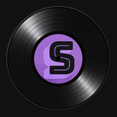

# Stash

### your Spotify + YouTube Music library, on your phone

[](https://github.com/rawnaldclark/Stash/releases/latest)
[](https://github.com/rawnaldclark/Stash/releases)
[](https://github.com/rawnaldclark/Stash/stargazers)
[](https://discord.gg/vcbjEby5PC)

[**Download**](#install) · [**Features**](#what-it-does) · [**Setup**](#first-time-setup) · [**FAQ**](#faq) · [**Support**](#support-stash)

</div>

<p align="center">
  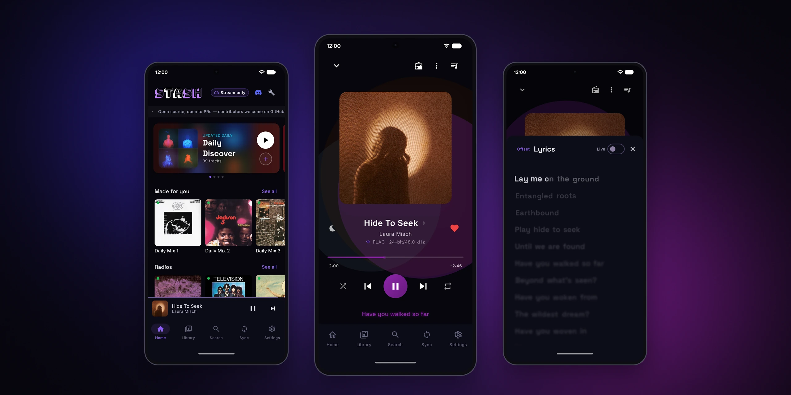
</p>

Stash grabs your Spotify and YouTube Music playlists and mirrors them on your Android phone. Download them, stream them, mix and match. Hi-res when it exists.

No Stash account, no analytics, your logins stay on your phone. Free and open source, forever.

---

## What it does

<table>
  <tr>
    <td width="50%" valign="top">

####  Your library, one place
- Spotify + YouTube Music together: liked songs, playlists, daily mixes
- Finds the right version of a song. Almost always. If it doesn't, flag it and pick the right one
- Your listening: top songs, stats, and a recap of your month
- Got your own music in Dropbox, OneDrive or Google Drive? Connect it and stream or download it like everything else (on Google Drive you pick the songs)

</td>
    <td width="50%" valign="top">

####  Download or stream
- Download your playlists or just stream them. Your call
- Pick your quality: Lossless, AAC 320 or Opus
- Downloaded songs play offline, the rest stream

</td>
  </tr>
  <tr>
    <td width="50%" valign="top">

####  Sound
- Real FLAC, up to Hi-Res
- 5-band EQ, bass boost, crossfade, normalizer
- Cast to Chromecast and Nest speakers

</td>
    <td width="50%" valign="top">

####  Lyrics
- Synced lyrics that light up word by word
- Pulled automatically, no setup

</td>
  </tr>
  <tr>
    <td width="50%" valign="top">

####  Finding new stuff
- Daily Discover, Stash Mixes and radios
- Last.fm recommendations
- Share songs and mixes as links, follow your friends' mixes

</td>
    <td width="50%" valign="top">

####  Social
- Listen Together, in sync with friends
- Last.fm and ListenBrainz scrobbling
- Discord status (what you're playing, with the art)

</td>
  </tr>
</table>

Dark, light and pure black themes. Everything optional is off until you turn it on.

<details>
<summary><b>More screenshots</b></summary>

### Dark

<table>
  <tr><td>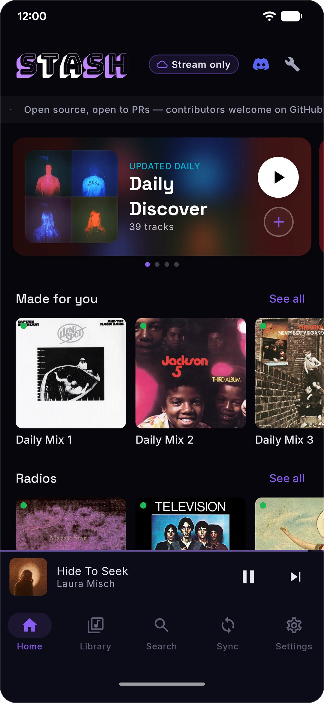</td><td>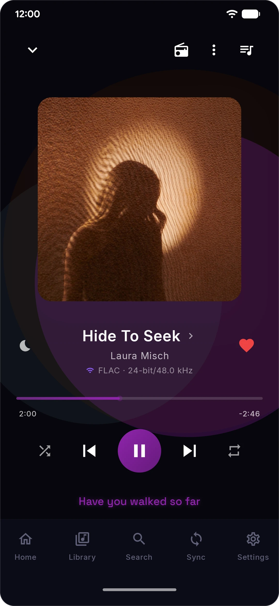</td><td>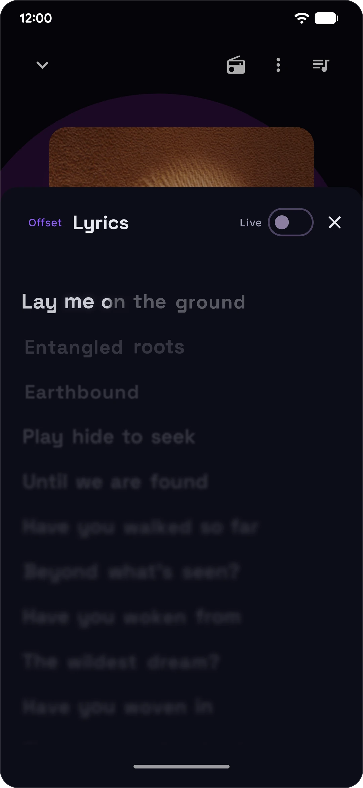</td><td>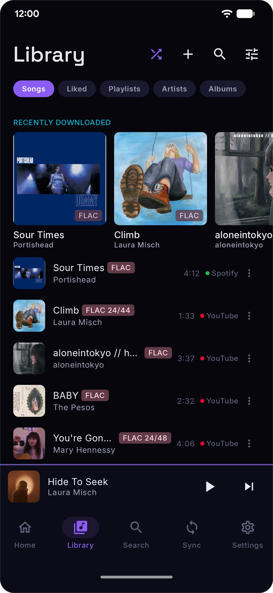</td></tr>
  <tr><td>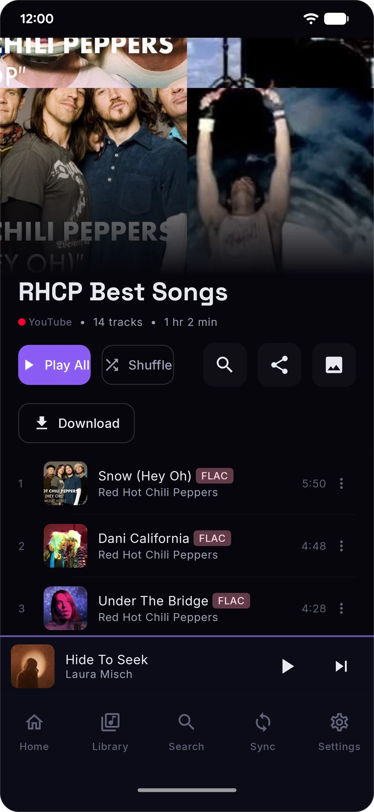</td><td>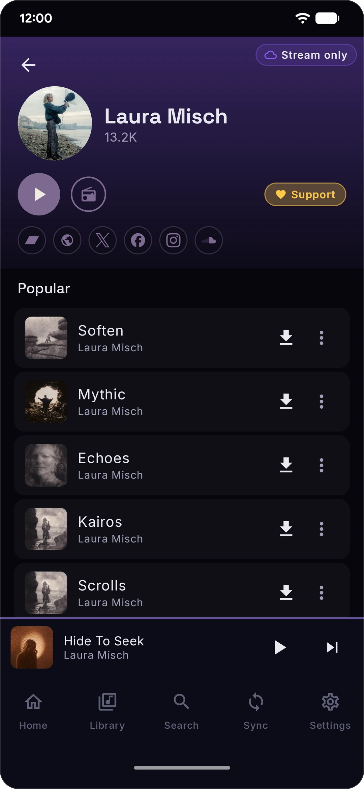</td><td>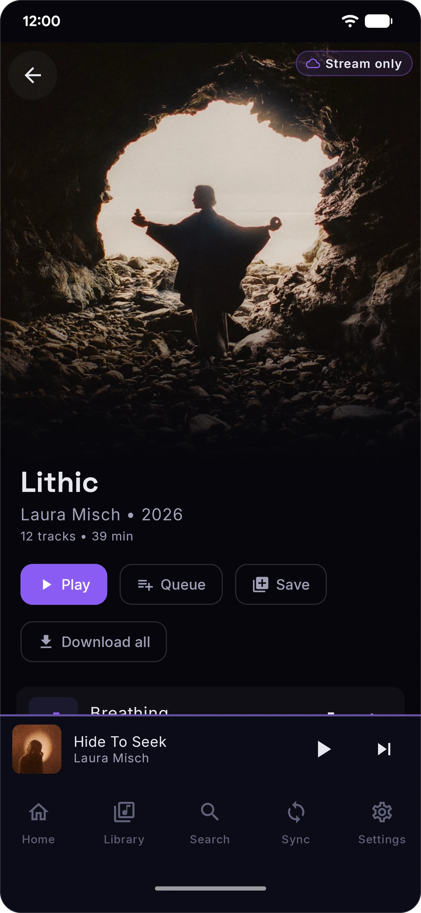</td><td>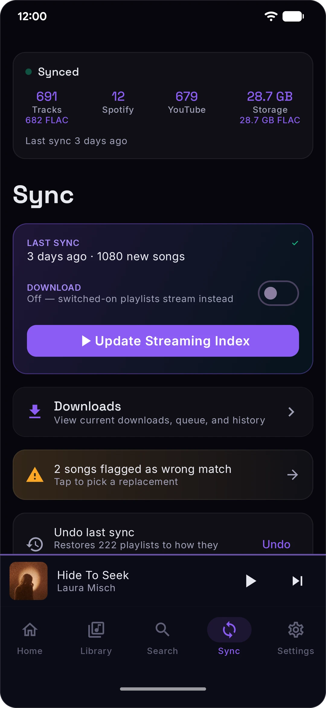</td></tr>
</table>

### Light

<table>
  <tr><td>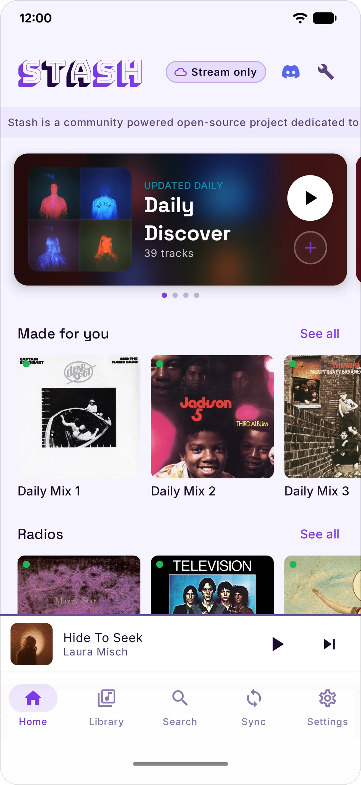</td><td>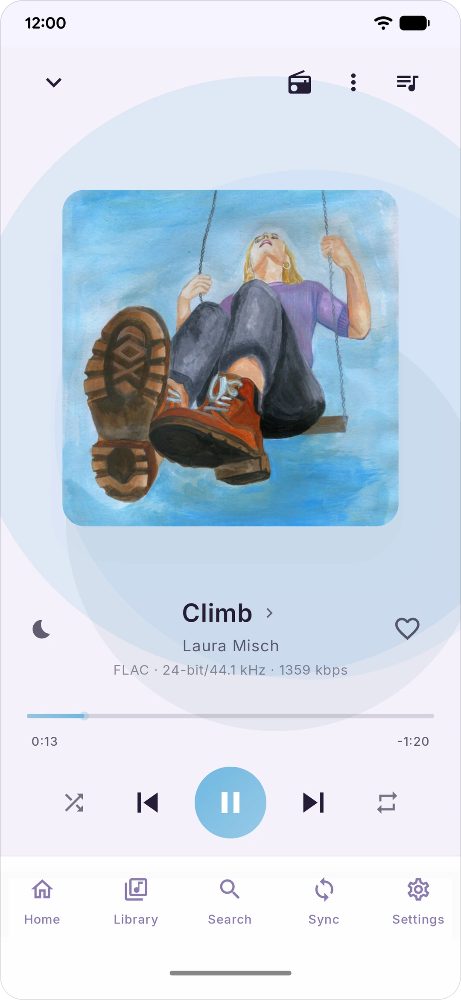</td><td>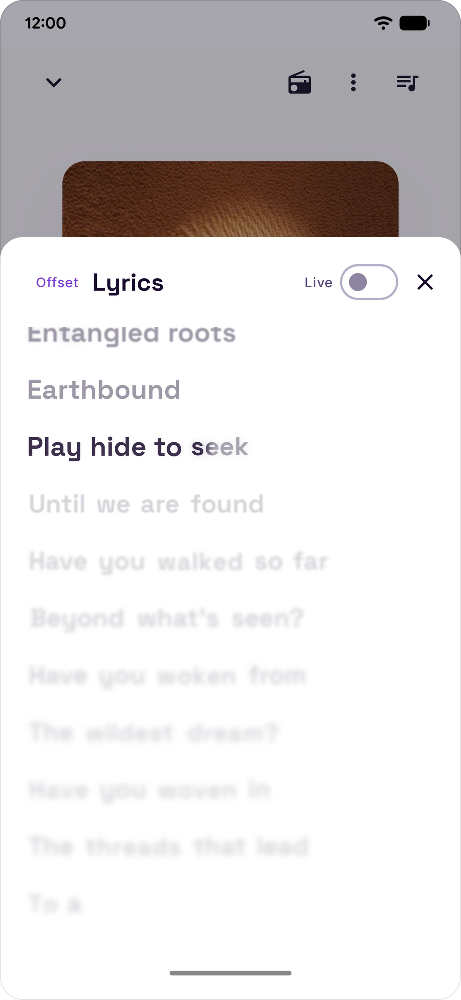</td><td>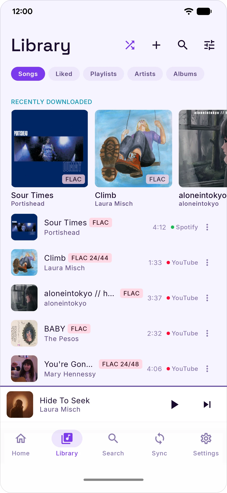</td></tr>
  <tr><td>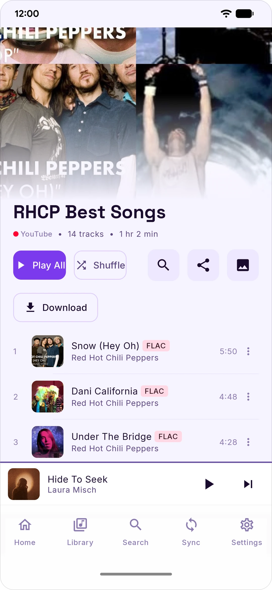</td><td>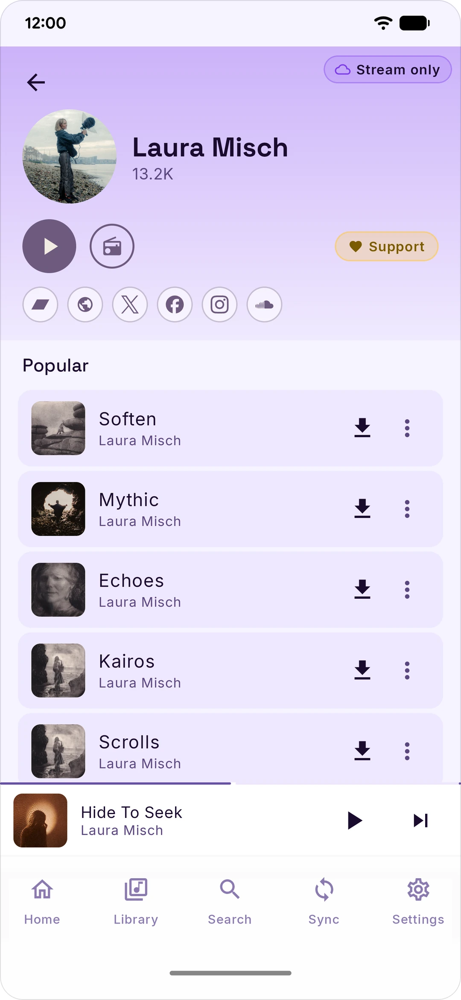</td><td>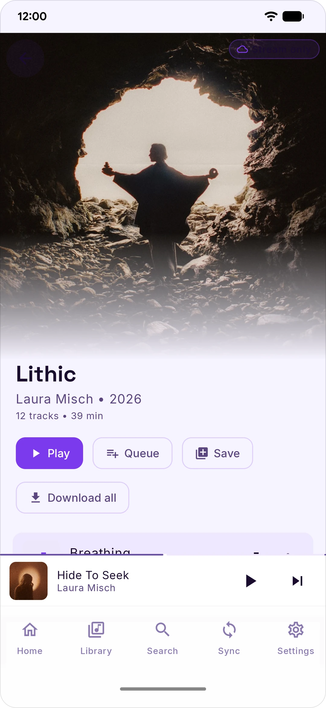</td><td>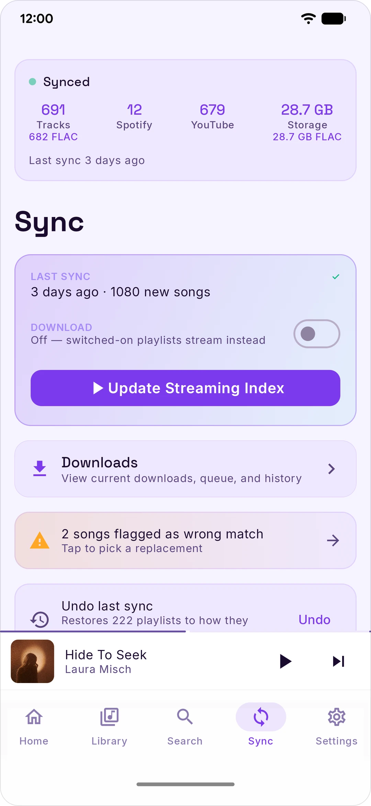</td></tr>
</table>

</details>

---

## Install

**Easiest:** grab `Stash.apk` from the [latest release](https://github.com/rawnaldclark/Stash/releases/latest), open it, tap Install. If Android grumbles about unknown sources, allow it for your browser and try again.

**Want auto-updates?** Use [Obtainium](https://obtainium.imranr.dev/) and add `https://github.com/rawnaldclark/Stash`. It'll ping you when there's a new version.

You need Android 8.0 or newer, and a Spotify and/or YouTube Music account.

<details>
<summary><b>Build it yourself</b></summary>

```bash
git clone https://github.com/rawnaldclark/Stash.git
cd Stash
./gradlew assembleDebug
# APK lands in app/build/outputs/apk/debug/
```

You'll need Android Studio Hedgehog (2023.1.1) or later, JDK 17, and Android SDK 35. A build from a plain checkout skips the project's lossless relay and Last.fm proxy. [CONTRIBUTING.md](CONTRIBUTING.md) has the rest.

</details>

---

## First-time setup

Open **Settings**, tap Spotify or YouTube Music under Accounts, tap **Connect** and sign in like normal. That's it. Then hit the Sync tab, pick the playlists and mixes you want, and tap Sync Now.

The first sync is the slow one (a big library with Download on can take an hour). After that it only grabs what's new. Turn on **Auto-sync** and forget about it.

Stash doesn't use Spotify's or YouTube's official APIs, because they don't let apps like this exist. It uses your login instead, the same way your browser does. Your login stays on your phone, encrypted, and only ever goes back to Spotify or YouTube.

<details>
<summary><b>🎵 Spotify sign-in not working? Paste the cookie</b></summary>

1. On a computer, open **[open.spotify.com](https://open.spotify.com)** and make sure you're logged in.
2. Press **F12** to open Developer Tools.
3. Open the **Application** tab (it's **Storage** on Firefox). Click the `>>` arrows if you don't see it.
4. In the left sidebar, expand **Cookies** → click `https://open.spotify.com`.
5. Find the cookie named **`sp_dc`**, double-click its value and copy it.
6. In Stash: **Settings** → **Spotify** → **Connect** → **Paste cookie** (top right).
7. Paste it and tap **Connect**.

Tip: cookies from incognito windows sometimes don't work. Use a normal window.

</details>

<details>
<summary><b>📺 YouTube Music sign-in not working? Paste the cookie</b></summary>

1. On a computer, open **[music.youtube.com](https://music.youtube.com)** and make sure you're logged in.
2. Press **F12** and click the **Network** tab.
3. Refresh the page (F5).
4. Type **`browse`** in the filter box and click any request in the list.
5. Under **Request Headers**, find the line starting with **`cookie:`** and copy everything after it. It's long, that's normal.
6. In Stash: **Settings** → **YouTube Music** → **Connect**, paste it, tap **Connect**.

Same incognito tip as Spotify.

</details>

<details>
<summary><b>🎮 Discord status (read this first)</b></summary>

Discord has no official way for a phone app to show what you're playing, so Stash does it through your own account's session (the same trick PreMiD and similar tools use). It's not a bot and it only sets your status.

> **Heads up:** Discord calls this kind of thing a *self-bot* in its [Platform Manipulation Policy](https://discord.com/safety/platform-manipulation-policy-explainer), and its [support article](https://support.discord.com/hc/en-us/articles/115002192352-Automated-User-Accounts-Self-Bots) says it can get an account banned. In practice they go after spam, not music statuses, so the risk is low. But it's your account, so it's your call. The app asks before connecting, and everything else in Stash works fine without it.

To connect: **Settings** → **Discord** → **Connect**, and sign in. If that fails, tap **Paste token**: sign in at [discord.com/login](https://discord.com/login) on a computer, open DevTools (F12) → **Application** → **Local Storage** → `https://discord.com`, and copy the `token` value.

Disconnecting clears your status right away and deletes the token from your phone.

</details>

---

## FAQ

<details>
<summary><b>Download or stream, what's the difference?</b></summary>
<br>

Flip **Download** on (Sync tab) and your playlists get saved to your phone so they play with no signal. Leave it off and they stream, taking almost no space. Either way, any single playlist has its own Download button. Stream on mobile data by turning on **Stream on cellular** in Settings.

</details>

<details>
<summary><b>Where does the FLAC come from?</b></summary>
<br>

Qobuz and Tidal. Stash looks every song up there. If you have a Qobuz account you can connect it in Settings and it uses yours. If not, it uses the project's relays, which hand your phone a link and the audio comes straight from Qobuz or Tidal. Everyone gets 500 lossless songs a day, which is a lot. No lossless copy? It plays AAC or Opus instead, and Now Playing tells you where it came from. The full details are in [PRIVACY.md](PRIVACY.md#where-lossless-comes-from).

</details>

<details>
<summary><b>Is my login safe?</b></summary>
<br>

Your logins live on your phone, encrypted, and only ever get sent back to the service they came from. There's no Stash server holding your stuff and no analytics. Want every single host Stash talks to and why? It's all in [PRIVACY.md](PRIVACY.md#what-stash-talks-to). Yes, all of it.

</details>

<details>
<summary><b>Why isn't it on the Play Store?</b></summary>
<br>

Google Play doesn't allow apps that save audio from YouTube. So it lives here.

Stash never downloads audio from Spotify. It reads your Spotify library with your login and finds each song somewhere else. It isn't affiliated with any of the services it connects to, and you're responsible for how you use it.

</details>

<details>
<summary><b>Sync keeps stopping in the background</b></summary>
<br>

Some phones (looking at you, Samsung, Xiaomi, OnePlus, Huawei) kill apps to save battery. Go to phone Settings → Apps → Stash → **Battery** and set it to **Unrestricted**. Still dying? [dontkillmyapp.com](https://dontkillmyapp.com/) has a fix for your exact phone.

</details>

<details>
<summary><b>Something broke / I want a feature</b></summary>
<br>

Bugs and ideas go in [Issues](https://github.com/rawnaldclark/Stash/issues). For everything else, come hang out in the [Discord](https://discord.gg/vcbjEby5PC). We're in there a lot and answer fast.

</details>

---

## Support Stash

Stash is free and always will be. If it's earned a spot on your phone and you want to chip in, it genuinely helps. Thank you 💜

<table>
  <tr>
    <td align="center" width="50%" valign="top">
      <a href="https://github.com/rawnaldclark"></a>
      <br><b>rawn</b>
      <br><sub>made Stash, main dev</sub>
      <br><br>
      <a href="https://ko-fi.com/rawnald"></a>
      <a href="https://www.paypal.me/rawnaldclark"></a>
      <br>
      <a href="https://github.com/sponsors/rawnaldclark"></a>
    </td>
    <td align="center" width="50%" valign="top">
      <a href="https://github.com/ParaliyzedEvo"></a>
      <br><b>Evo</b>
      <br><sub>co-dev, makes the beta builds</sub>
      <br><br>
      <a href="https://www.paypal.com/paypalme/Paraliyzedevo"></a>
    </td>
  </tr>
</table>

Can't donate? A star, a bug report or telling a friend helps just as much.

### Star history

<a href="https://star-history.com/#rawnaldclark/Stash&Date">
  <picture>
    <source media="(prefers-color-scheme: dark)" srcset="https://api.star-history.com/svg?repos=rawnaldclark/Stash&type=Date&theme=dark" />
    <source media="(prefers-color-scheme: light)" srcset="https://api.star-history.com/svg?repos=rawnaldclark/Stash&type=Date" />
    
  </picture>
</a>

---

## Help out

**Code:** pull requests welcome. [CONTRIBUTING.md](CONTRIBUTING.md) has how to build it and a map of the code. For anything big, open an issue first so we can talk it through.

**Translations:** want Stash in your language? Join the [Crowdin project](https://crowdin.com/project/stash-music-player) and [ask for translator access here](https://docs.google.com/forms/d/e/1FAIpQLSexDpqAvK82QlYYpC8J0ukwVXkzOQSjC8V10SPVbj1ug0ojow/viewform).

**Security:** found a hole? Please follow [SECURITY.md](SECURITY.md) instead of opening a public issue.

Everyone who's helped build Stash:

<p>
  <a href="https://github.com/rawnaldclark"></a>
  <a href="https://github.com/ParaliyzedEvo"></a>
  <a href="https://github.com/chaudhary-lakshay"></a>
  <a href="https://github.com/arpitagarwal1301"></a>
  <a href="https://github.com/yuriikot2010"></a>
  <a href="https://github.com/JoshDui"></a>
  <a href="https://github.com/winstriker"></a>
  <a href="https://github.com/devRoemer"></a>
  <a href="https://github.com/midlan"></a>
</p>

---

## Thanks to

Stash stands on a lot of great open-source work:

- **[yt-dlp](https://github.com/yt-dlp/yt-dlp)**, the YouTube extraction backbone, and **[youtubedl-android](https://github.com/JunkFood02/youtubedl-android)**, its Android bindings
- **[QuickJS-NG](https://github.com/quickjs-ng/quickjs)**, a tiny JS engine for YouTube's signature challenges
- **[Media3 / ExoPlayer](https://github.com/androidx/media)** for playback
- **[ytmusicapi](https://github.com/sigma67/ytmusicapi)**, the YouTube Music reverse-engineering reference
- **[Spicy Lyrics](https://github.com/Spikerko/spicy-lyrics)**, the reference for the word-synced lyrics look
- **[paxsenix's lyrics API](https://lyrics.paxsenix.org/)** and itunes.apple.com for word-synced Apple Music lyrics
- **[Bungee Shade](https://fonts.google.com/specimen/Bungee+Shade)**, the wordmark font, by David Jonathan Ross (SIL OFL)
- **Discord logo** from Simple Icons (CC0)

---

## Legal disclaimer

Stash is an independent, unofficial project. It is **not affiliated with, endorsed by, or sponsored by Spotify, YouTube, Google, Qobuz, Tidal, Apple, Deezer, Discord, Last.fm, ListenBrainz, MusicBrainz, JioSaavn, KuGou, LRCLIB, or any other service it connects to.** Third-party names and logos here are used only to identify the services they belong to, and all trademarks belong to their respective owners.

Stash is a tool for managing your own music library. You're responsible for complying with the Terms of Service of any music service you use Stash with. Downloading copyrighted content without a license may be illegal in your jurisdiction. The Stash project accepts no responsibility for misuse.

### Takedown and abuse reports

Rights holders, service operators, and anyone else with a takedown or abuse report: email **[legal@stashfm.app](mailto:legal@stashfm.app)**, which reaches the maintainer directly. You can also open an issue on [GitHub Issues](https://github.com/rawnaldclark/Stash/issues) or, if the report shouldn't be public, file a [private security advisory](https://github.com/rawnaldclark/Stash/security/advisories/new). Reports are read, and a source can be removed from the app in a release.

---

## License

Copyright © 2026 Rawnald Clark

Stash is free software: you can redistribute it and/or modify it under the terms of the [GNU General Public License](LICENSE), either version 3 of the License, or (at your option) any later version.

This program is distributed in the hope that it will be useful, but **WITHOUT ANY WARRANTY**; without even the implied warranty of MERCHANTABILITY or FITNESS FOR A PARTICULAR PURPOSE. See the LICENSE file for the full text.
